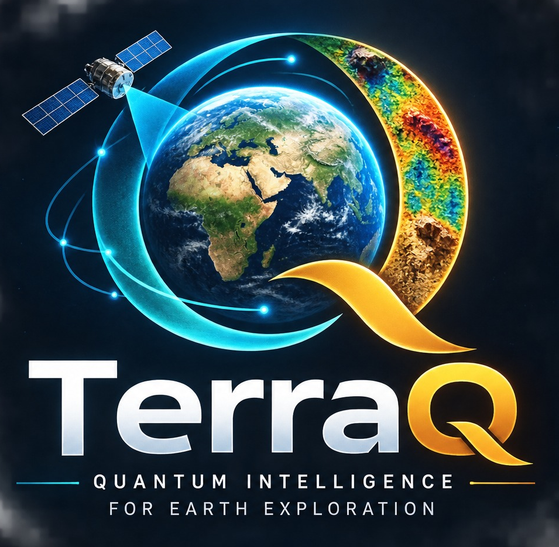
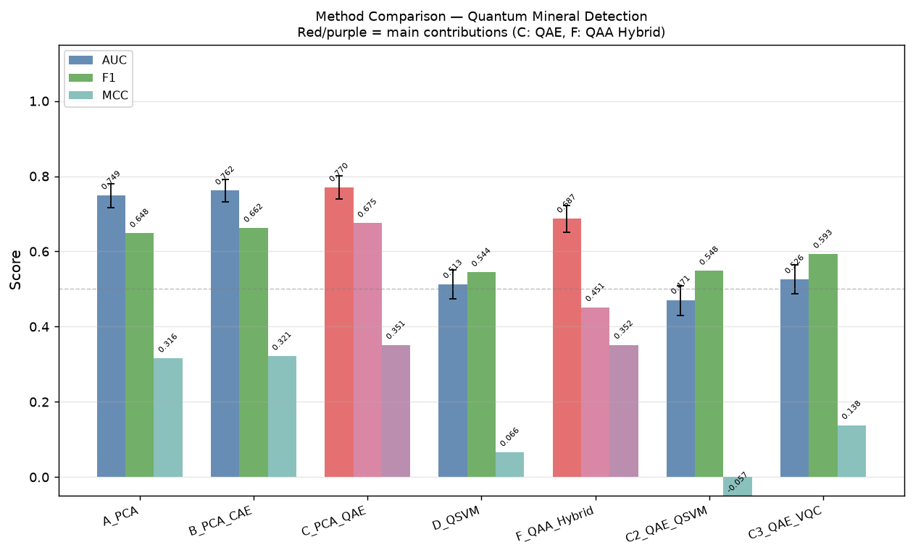
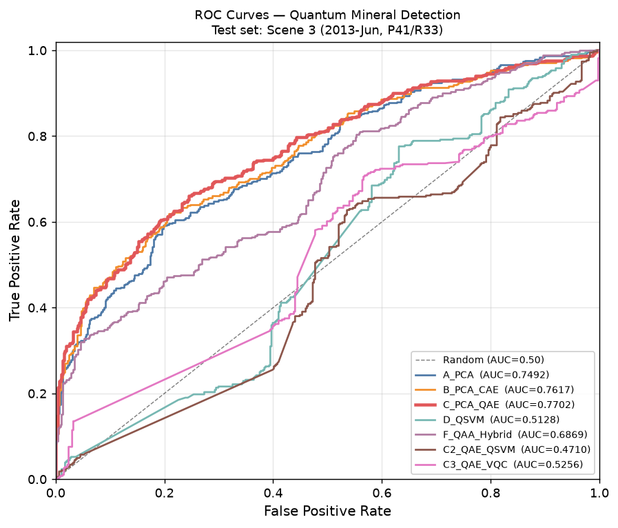
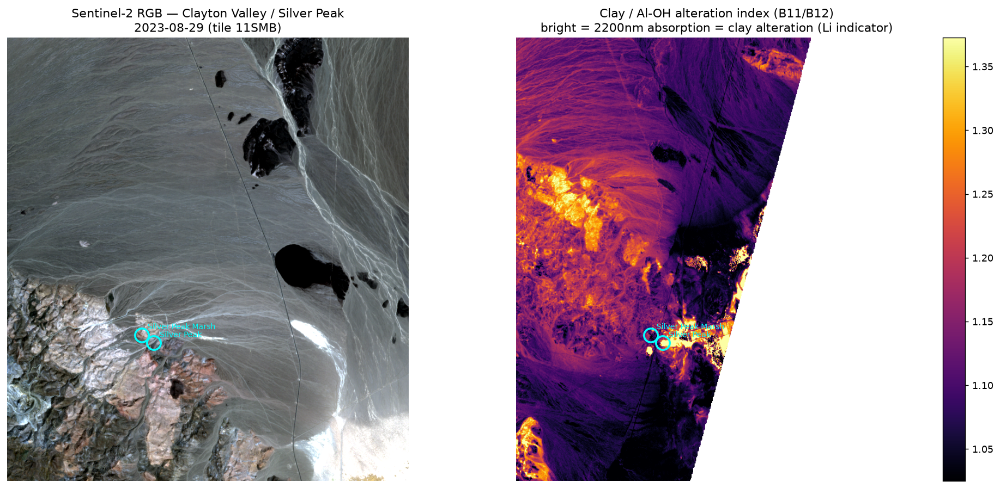
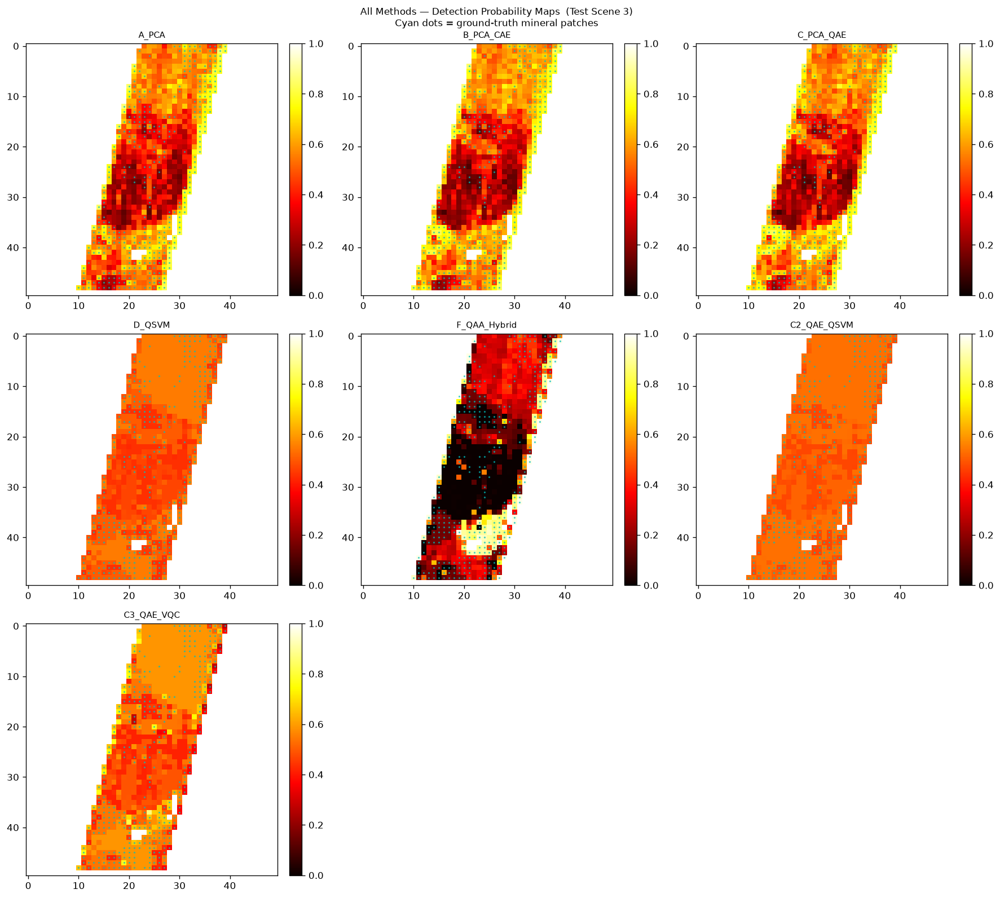
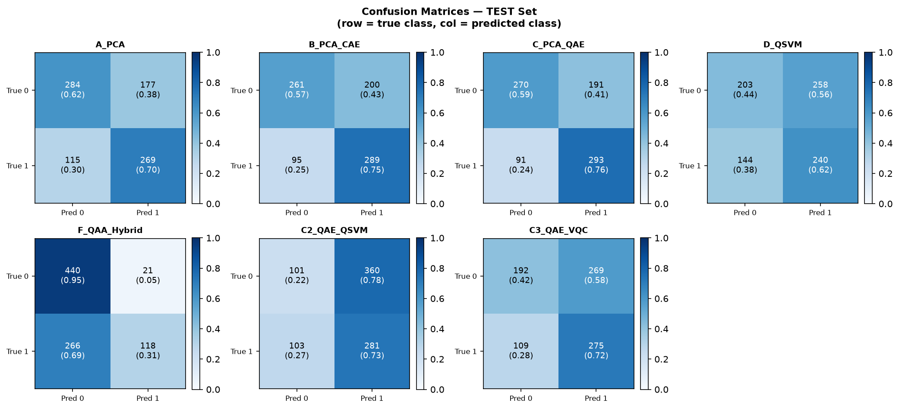
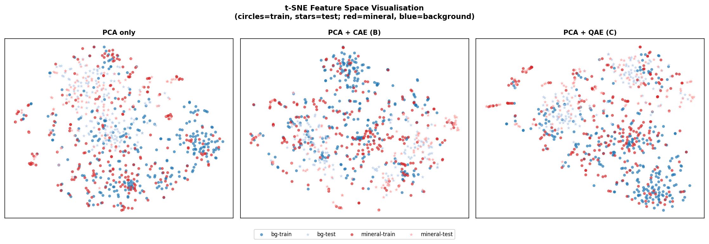
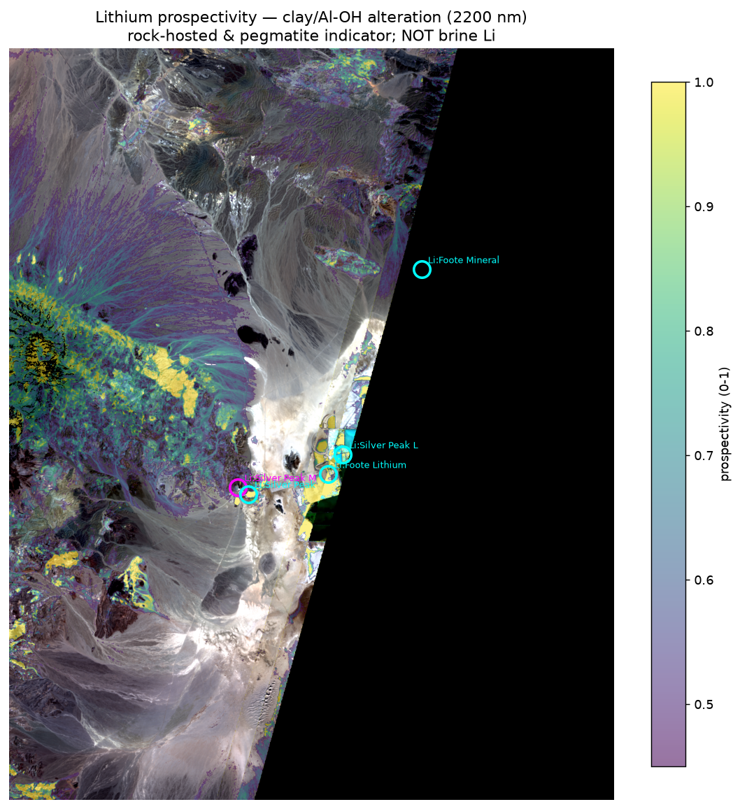
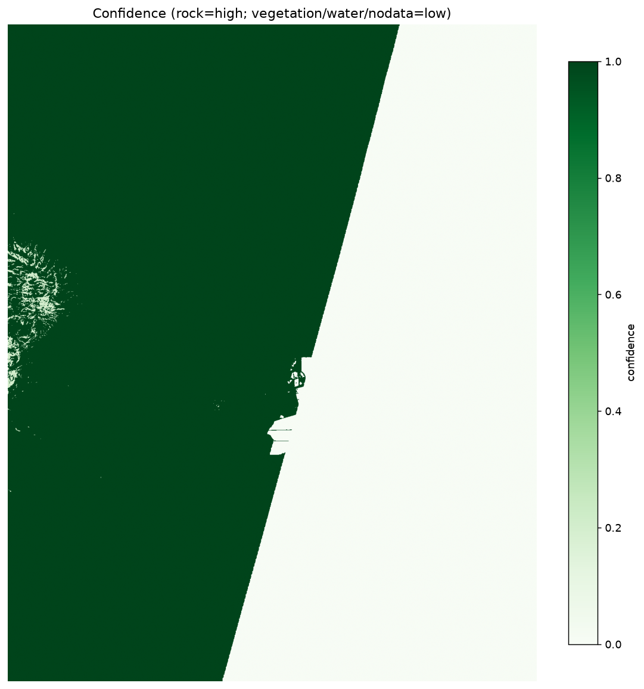
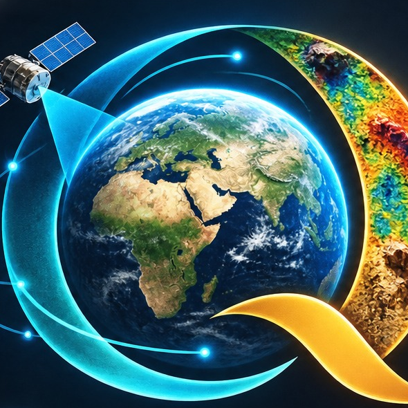

<p align="center">
  
</p>

<h3 align="center">Hybrid quantum–classical mineral prospecting from satellite imagery</h3>

<p align="center">
  A 6‑qubit Quantum Autoencoder for lithium &amp; vanadium detection in hyperspectral data,
  a live Sentinel‑2 prospectivity engine, and an interactive web console.
</p>

<p align="center">
  <a href="https://www.python.org/"></a>
  <a href="https://pennylane.ai/"></a>
  <a href="https://pytorch.org/"></a>
  <a href="https://nextjs.org/"></a>
  <a href="https://react.dev/"></a>
  <a href="https://www.typescriptlang.org/"></a>
  
</p>

<p align="center">
  <a href="https://vercel.com/new/clone?repository-url=https%3A%2F%2Fgithub.com%2Faad1tyaaaaa%2FTerraQ&root-directory=terraq&env=NEXT_PUBLIC_ENGINE_URL&envDescription=URL%20of%20the%20deployed%20Render%20engine"></a>
  &nbsp;
  <a href="https://render.com/deploy?repo=https://github.com/aad1tyaaaaa/TerraQ"></a>
</p>

---

## Contents

- [Overview](#overview)
- [Tech stack](#tech-stack)
- [Key results](#key-results)
- [Architecture](#architecture)
- [Gallery](#gallery)
- [Getting started](#getting-started)
- [Deployment](#deployment)
- [Repository structure](#repository-structure)
- [Reproducibility](#reproducibility)
- [Scope &amp; limitations](#scope--limitations)
- [References](#references)

---

## Overview

Classical hyperspectral mineral detection struggles with high‑dimensional, noisy
satellite data: correlated bands and weak, overlapping absorption features reduce
sensitivity. TerraQ asks a focused question:

> **Can a quantum autoencoder encode spectral patterns that a classical autoencoder
> of identical bottleneck width cannot — and does that improve mineral detection?**

The project has three parts:

| Component | Folder | What it does | Quantum? |
|---|---|---|---|
| **Research pipeline** | `src/`, `experiments/` | Trains and benchmarks 7 detection methods on NASA EO‑1 Hyperion imagery | ✅ QAE · QAA · QSVM · VQC |
| **Prospectivity engine** | `product/` | Turns any lat/lon into lithium / vanadium maps from live Sentinel‑2 data | ❌ Classical spectral indices |
| **Web console** | `terraq/` | Next.js dashboard, results explorer and live‑analysis UI | ❌ UI layer |

> **Note:** the quantum results come from the research pipeline on Hyperion. The live
> maps in the web console come from the classical Sentinel‑2 engine.

---

## Tech stack

| Layer | Technologies |
|---|---|
| **Quantum ML** | PennyLane (simulator), Hardware‑Efficient Ansatz QAE, ZZFeatureMap QSVM, VQC |
| **Classical ML** | PyTorch, scikit‑learn (RF · Gradient Boosting · SVM ensemble), PCA, NumPy, SciPy |
| **Geospatial** | Rasterio (bundled GDAL), PyProj, Sentinel‑2 COGs via Element84 Earth Search STAC, USGS MRDS, USGS Spectral Library v7 |
| **Backend** | Python standard‑library HTTP server (`product/server.py`), Matplotlib, Pillow |
| **Frontend** | Next.js 16 (App Router), React 19, TypeScript, Tailwind CSS 4, Radix UI / shadcn, MapLibre GL, Recharts, GSAP |
| **AI assistant** | Groq / Gemini via server‑side API routes (optional, template fallback) |
| **Deployment** | Vercel (web console) · Render (engine) |

---

## Key results

Measured on the temporal hold‑out test scene (Scene 3, never seen in training).
Source of truth: [`outputs/summary/metrics.txt`](outputs/summary/metrics.txt).

| Method | Description | AUC | F1 | MCC | 95% CI (AUC) |
|---|---|---|---|---|---|
| **A** | PCA only — classical baseline | 0.749 | 0.648 | 0.316 | [0.717, 0.780] |
| **B** | PCA + classical autoencoder | 0.762 | 0.662 | 0.321 | [0.731, 0.792] |
| **C** ★ | **PCA + 6‑qubit Quantum Autoencoder** | **0.770** | **0.675** | **0.351** | [0.739, 0.801] |
| **F** | QAA hybrid — unsupervised anomaly + pseudo‑labels | 0.687 | 0.451 | 0.352 | [0.652, 0.723] |
| **D** | QSVM — ZZFeatureMap kernel | 0.513 | 0.544 | 0.066 | [0.473, 0.552] |
| **C3** | QAE → VQC, end‑to‑end quantum | 0.526 | 0.593 | 0.138 | [0.487, 0.565] |
| **C2** | QAE → QSVM, stacked quantum | 0.471 | 0.548 | −0.057 | [0.429, 0.509] |

**Method C (PCA + QAE)** leads on AUC, F1 and MCC: **+2.1% AUC over the PCA baseline**
and **+0.9% AUC over the classical‑autoencoder ablation**. A paired McNemar test
(C vs B: χ² = 2.62, p = 0.106) shows the lift is consistent but **not yet statistically
significant** — see [Scope &amp; limitations](#scope--limitations).

<p align="center">
  
  
</p>

---

## Architecture

### Deployment topology

```
 ┌──────────────────────┐   HTTPS (CORS)   ┌───────────────────────────┐   STAC + COG   ┌──────────────────┐
 │  Web console         │ ───────────────▶ │  Prospectivity engine     │ ─────────────▶ │  Sentinel-2 L2A  │
 │  Next.js on Vercel   │  /api/analyze    │  Python on Render         │                │  (AWS open data) │
 │  + /api/* (LLM, geo) │ ◀─────────────── │  product/server.py        │                └──────────────────┘
 └──────────────────────┘   maps + JSON    └───────────────────────────┘
```

### Research pipeline

```
 Hyperion scene (198 bands, 30 m)
            │
            ▼
 ┌──────────────────────────────────────────────┐
 │ Preprocessing                                │
 │ • bad-band removal → 198 calibrated bands    │
 │ • center crop + 16×16 non-overlapping patches│
 │ • brightness / flatness quality filters      │
 │ • Scenes 1+2+4 → TRAIN  |  Scene 3 → TEST    │
 └───────────────────┬──────────────────────────┘
                     ▼
 ┌──────────────────────────────────────────────┐
 │ Physics-based labels (NOT used as features)  │
 │ LiCI @2200 nm (Li-OH)  ·  VMI @2265 nm (V-OH)│
 │ 75th-pct threshold, OR logic → no circularity│
 └───────────────────┬──────────────────────────┘
                     ▼
 ┌──────────────────────────────────────────────┐
 │ Shared stage: RobustScaler → PCA(25)         │  identical for ALL methods
 └───────────────────┬──────────────────────────┘
        ┌────────────┼─────────────────────────────┐
        ▼            ▼                             ▼
   A: ensemble   B: +classical AE (6D)     C: +6-qubit QAE → ⟨Z₀…Z₅⟩
   (RF+GB+SVM)      bottleneck               33-D feature vector → ensemble ★
                                            (also → C2 QSVM, C3 VQC)
        ▼
   D: ZZFeatureMap quantum kernel SVM
        ▼
   F: unsupervised QAA on background only → pseudo-labels → ensemble
```

**Method C:** PCA(25) → tanh scaling → 6‑qubit Hardware‑Efficient Ansatz QAE (data
re‑uploading + 3 variational layers) → 6 expectation values ⟨Z₀⟩…⟨Z₅⟩, concatenated
with the 25 PCA scores and 2 USGS spectral‑correlation features → 33‑D vector →
RF + Gradient Boosting + SVM ensemble.

| | QAE (C / C2 / C3) | QAA (F) |
|---|---|---|
| Type | Supervised feature extractor | Unsupervised anomaly detector |
| Trains on | Labelled mineral + background | Background only |
| Loss | MSE on reconstruction | 1 − P(trash = \|0000⟩) |
| Output | 6 expectation values | Scalar anomaly score ∈ [0, 1] |

---

## Gallery

<p align="center">
  
</p>
<p align="center"><i>Engine prospectivity vs. known USGS lithium deposits — Clayton Valley / Silver Peak, Nevada.</i></p>

<p align="center">
  
</p>
<p align="center"><i>Detection probability maps for all seven methods (Hyperion).</i></p>

<p align="center">
  
  
</p>
<p align="center"><i>Left: per‑method confusion matrices. Right: t‑SNE of PCA vs CAE vs QAE feature spaces.</i></p>

<p align="center">
  
  
</p>
<p align="center"><i>Sentinel‑2 lithium (clay / Al‑OH) prospectivity and data‑confidence map, Clayton Valley, NV.</i></p>

---

## Getting started

### Prerequisites

- Python 3.12
- Node.js 18+ (20 LTS recommended)

### 1. Clone

```bash
git clone https://github.com/aad1tyaaaaa/TerraQ.git
cd TerraQ
```

### 2. Run the web console + engine together

```bash
python3.12 -m venv .venv
./.venv/bin/pip install -r product/requirements.txt   # engine only (lightweight)
cd terraq && npm install && cd ..

bash start.sh     # prints the URLs it bound to
bash stop.sh      # stops only what start.sh started
```

`start.sh` prefers `:3000` (console) and `:8765` (engine) and falls back to the next free
port if one is taken. Force ports with `DASH_PORT=3005 ENGINE_PORT=8770 bash start.sh`.

### 3. Or run each part on its own

**Web console** — every tab except *Live Analysis* works offline from committed images:

```bash
cd terraq
cp .env.example .env.local    # optional: LLM keys, engine URL
npm run dev                   # http://localhost:3000
```

**Prospectivity engine:**

```bash
./.venv/bin/python -u product/server.py      # http://localhost:8765

# one-shot CLI for a single location
./.venv/bin/python product/sentinel_engine.py --lat 37.7499 --lon -117.6342 --km 12 --out outputs/my_area
```

A cold request takes several minutes (~7 min for a 12 km radius): it streams
Sentinel‑2 COGs from a public S3 bucket, so latency dominates. Repeat requests for the
same `(lat, lon, km)` are served instantly from `outputs/jobs/`.

**Quantum research pipeline (Hyperion):**

```bash
./.venv/bin/pip install -r requirements.txt   # full stack: PennyLane, PyTorch, …
# place raw Hyperion scenes under data/ and preprocess — see data/README.md
./.venv/bin/python experiments/run_pipeline.py          # ~1 h on CPU
QMD_OUTPUT_DIR=outputs_rerun ./.venv/bin/python experiments/run_pipeline.py   # keep existing results
```

### Environment variables

Set in `terraq/.env.local` locally, or in the Vercel project settings. All are optional.

| Variable | Scope | Purpose |
|---|---|---|
| `NEXT_PUBLIC_ENGINE_URL` | Browser | Engine base URL (default `http://localhost:8765`) |
| `LLM_PROVIDER` | Server | `groq` or `gemini` |
| `GROQ_API_KEY` | Server | Groq key for target explanations / assistant |
| `GROQ_MODEL`, `GROQ_FALLBACK_MODEL` | Server | Groq model chain |
| `GEMINI_API_KEY` | Server | Backup LLM provider |

Without LLM keys, explanations fall back to a deterministic template. Never prefix secret keys with `NEXT_PUBLIC_`.

---

## Deployment

The console and the engine deploy separately. Deploy the **engine first**, because the
console needs its URL.

### 1. Engine → Render

The repository includes a [`render.yaml`](render.yaml) Blueprint.

1. Click **Deploy to Render** above, or go to *Render → New → Blueprint* and select this repo.
2. Render installs `product/requirements.txt` and starts `python -u product/server.py`,
   which binds to the `$PORT` Render provides.
3. Copy the service URL, e.g. `https://terraq-engine.onrender.com`.

### 2. Web console → Vercel

1. Click **Deploy with Vercel** above, or import the repo at *vercel.com/new*.
2. Set **Root Directory** to `terraq` (the button does this for you). Framework is auto‑detected as Next.js.
3. Add environment variables: `NEXT_PUBLIC_ENGINE_URL` = your Render URL, plus any LLM keys.
4. Deploy. Redeploy after changing `NEXT_PUBLIC_ENGINE_URL`, because it is inlined at build time.

### Production notes

- **Render free plan** sleeps after ~15 min idle (the first request then takes ~1 min to wake)
  and has 512 MB RAM. Large search radii may need a paid instance.
- The engine's job cache (`outputs/jobs/`) is on ephemeral disk and resets on redeploy.
  Attach a Render persistent disk if you want to keep cached results.
- The engine allows cross‑origin requests from any origin (`Access-Control-Allow-Origin: *`).
  Restrict this in `product/server.py` if you deploy publicly.

---

## Repository structure

```
TerraQ/
├── README.md
├── render.yaml                  ← Render Blueprint (engine)
├── requirements.txt             ← full research stack (PennyLane, PyTorch, …)
├── start.sh / stop.sh           ← run console + engine locally
│
├── experiments/
│   └── run_pipeline.py          ← single entry point — runs all 7 methods
├── src/
│   ├── config.py                ← all hyperparameters (single source of truth)
│   ├── pipeline/                ← features, ensemble, metrics, maps, viz
│   └── quantum/                 ← qae.py · qaa.py · qsvm.py · vqc.py
│
├── product/                     ← classical Sentinel-2 engine + API server
│   ├── requirements.txt         ← lean engine dependencies (Render)
│   ├── sentinel_engine.py       ← coordinate → prospectivity maps
│   └── server.py                ← HTTP API (port $PORT, default 8765)
│
├── terraq/                      ← Next.js web console (Vercel root directory)
│   ├── app/                     ← routes: /, /dashboard, /explorer, /live-analysis, /api/*
│   ├── components/  explorer/  hooks/  lib/
│   └── public/                  ← logo, committed maps and figures
│
├── data/ground_truth/*.csv      ← USGS MRDS deposit labels
├── outputs/summary/             ← research figures + metrics
├── outputs/sentinel2_results/   ← engine validation outputs
└── docs/                        ← paper outline, technical manual, quantum advantage
```

Raw Hyperion TIFs (~17 GB), processed cubes, `node_modules` and build caches are gitignored.

---

## Reproducibility

| Setting | Value |
|---|---|
| Random seed | 42 (NumPy, Python, PyTorch) |
| PCA components | 25 |
| QAE qubits / layers | 6 / 3 |
| QAE training samples | 200 balanced (100 + / 100 −) |
| QAA qubits / latent / trash | 6 / 2 / 4 |
| Quantum backend | PennyLane simulator |
| Test set | Scene 3 only (temporal hold‑out) |
| Labels | 75th‑percentile threshold on LiCI + VMI, training set only (OR logic) |

A config hash is printed at pipeline start, so any parameter change is detectable.

---

## Scope & limitations

TerraQ is a **research prototype and candidate‑target generator**, not a discovery tool.

- **The quantum lift is modest and not yet statistically significant** (McNemar C vs B, p = 0.106).
- **Quantum models run on a simulator**, not real hardware. Full‑scene pixel‑wise quantum
  inference is not yet practical, so wide‑area scanning is classical by design.
- **The live console is classical** — Sentinel‑2 band‑ratio indices (clay / Al‑OH for Li,
  iron‑oxide + mica for V).
- **Optical sensing sees surface alteration only** — not brine lithium or buried deposits.
- **Prospectivity is a normalised 0–1 alteration score**, not a calibrated probability.
  Anomalies are leads that need field survey and drilling to confirm.

---

## References

1. Romero, Olson & Aspuru‑Guzik (2017). *Quantum autoencoders for efficient compression of quantum data.* Quantum Sci. Technol. 2(4), 045001.
2. Havlíček et al. (2019). *Supervised learning with quantum‑enhanced feature spaces.* Nature 567, 209–212.
3. Pérez‑Salinas et al. (2020). *Data re‑uploading for a universal quantum classifier.* Quantum 4, 226.
4. Biamonte et al. (2017). *Quantum machine learning.* Nature 549, 195–202.
5. Bergholm et al. (2022). *PennyLane: Automatic differentiation of hybrid quantum‑classical computations.* arXiv:1811.04968.
6. Kokaly et al. (2017). *USGS Spectral Library Version 7.* USGS Data Series 1035.
7. Van der Meer (2004). *Analysis of spectral absorption features in hyperspectral imagery.* Int. J. Appl. Earth Obs. 5(1), 55–68.

---

<p align="center">
  <br>
  <sub><b>TerraQ</b> · Quantum Intelligence for Earth Exploration</sub>
</p>
