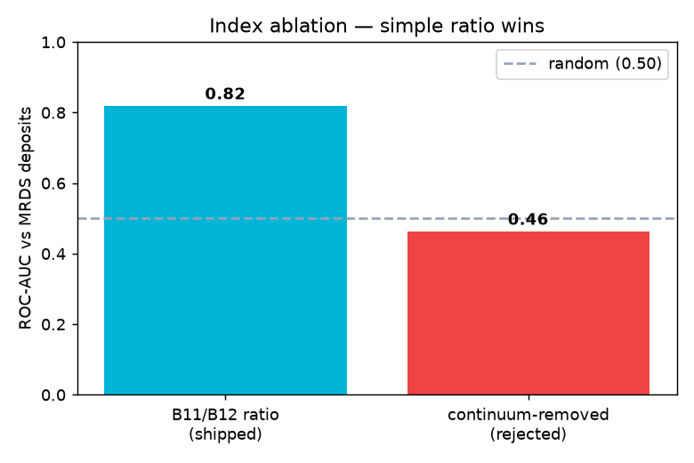
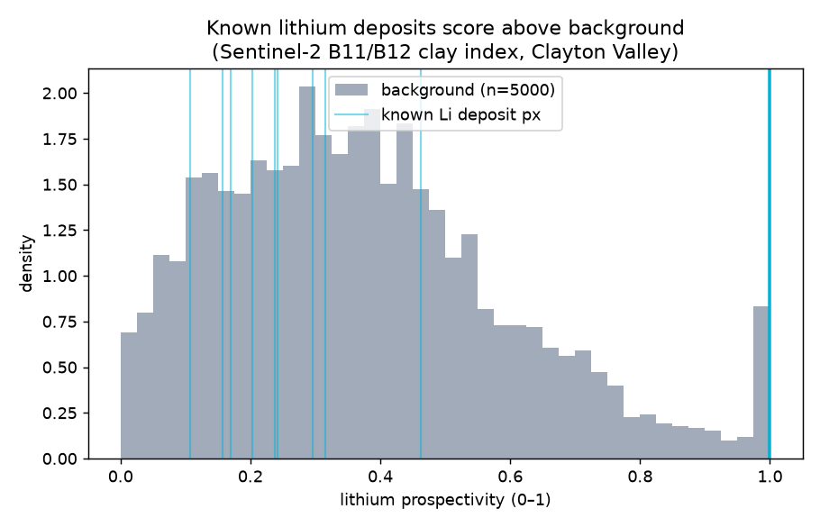

# Sentinel-2 Product — Metrics & Benchmark

**Product:** lithium surface-alteration index (Sentinel-2 L2A, B11/B12 clay / Al-OH ratio)
**Test area:** Clayton Valley / Silver Peak, Nevada
**Ground truth:** USGS MRDS known lithium occurrences (real deposits, not pseudo-labels)

## Headline metrics (shipped model)

| Metric | Value | Meaning |
|---|---|---|
| ROC-AUC | **0.82** | known deposit pixels rank above background |
| Hit-rate @ top 5% | **0.75** | fraction of rock-hosted sites in the top 5% of the map |
| Hit-rate @ top 10% | **0.75** | …in the top 10% |
| Deposit median percentile | **98** | where deposits sit on the prospectivity map |
| Positives / Background | 36 px / 5000 px | from 4 rock-hosted sites |

## Index ablation (why the simple ratio is shipped)

| Index | ROC-AUC | Decision |
|---|---|---|
| **B11/B12 ratio** | **0.82** | ✅ shipped |
| Continuum-removed depth | 0.46 | ❌ rejected (worse than random; S2 has only 2 SWIR bands) |




## Per-deposit
| Site | type | score | percentile |
|---|---|---|---|
| Silver Peak Marsh | rock | 0.24 | 31 |
| Silver Peak | rock | 1.00 | 98 |
| Foote Lithium Brine Operation. | rock | 1.00 | 98 |
| Silver Peak Lithium Operations | rock | 1.00 | 98 |
| Foote Mineral Co. | playa/nodata | 0.00 | 0 |

## Honest caveats
- **Small, clustered ground truth** (4 rock-hosted sites, mostly Silver Peak) → this is an
  *indicative validation* ("does the index rank known deposits above background?"), **not** a
  generalisation accuracy. Treat ROC-AUC 0.82 as a credibility check, not a guarantee.
- Scores are **normalised alteration values [0,1]**, not calibrated probabilities.
- Detects **rock/clay-hosted & pegmatite** Li alteration only — **not** brine Li (under playas) or
  buried deposits (a physical limit of optical remote sensing).
- Preprocessing: SCL cloud/shadow/snow/water masking is applied; no topographic correction yet.

## Reproduce
```
.venv/bin/python product/benchmark_sentinel.py product_demo_v2   # raw numbers
.venv/bin/python product/build_results.py                        # this folder
```
